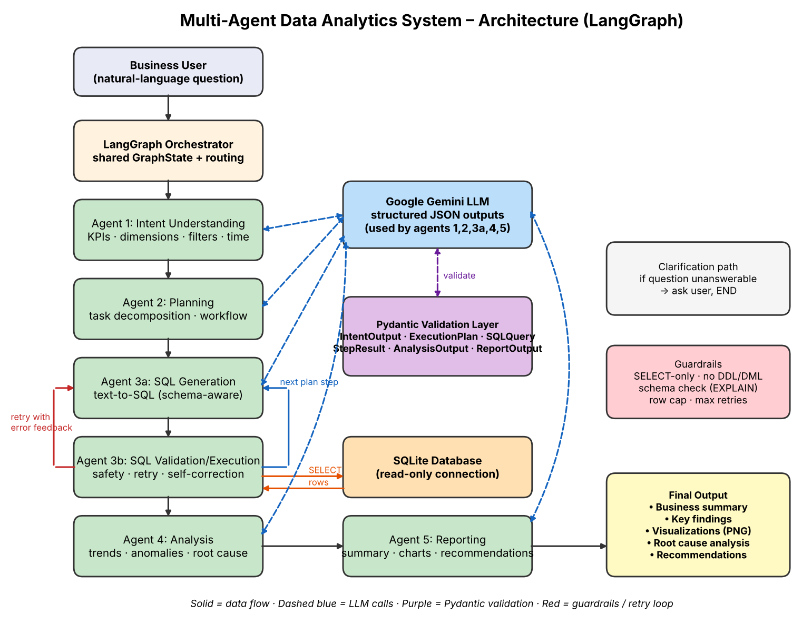

# Autonomous Multi-Agent Business Data Analytics Platform

Ask business questions in plain English. Five collaborating agents (orchestrated with **LangGraph**) understand the
question, plan the analysis, generate and validate SQL, analyse the data (trends, anomalies, root cause) and produce an
executive report with charts and recommendations.

**Stack:** Google Gemini (LLM) · SQLite (DB) · Pydantic (validation) · LangGraph · pandas · matplotlib

## Architecture


## Agents
1. **Intent Understanding** – KPIs, dimensions, filters, time periods, structured query requirements
2. **Planning** – decomposes the request into an ordered workflow and data requirements
3. **SQL Generation** – text-to-SQL, schema validation, execution, retries / query correction
4. **Analysis** – trend analysis, root-cause analysis, anomaly detection, drivers and patterns
5. **Reporting** – business summary, visualizations, key findings, recommendations

## Project layout
```
main.py              CLI (single question / interactive / --samples)
graph.py             LangGraph workflow, state, routing
schemas.py           Pydantic models (agent contracts)
llm.py               Gemini client with Pydantic-validated JSON output
database.py          SQLite schema introspection + SQL guardrails + read-only execution
create_sample_db.py  Builds the sample sales database
agents/              The five agents
tests/               Offline tests (fake LLM)
docs/                Architecture diagram, report template, video script
sample_questions.txt Sample questions
```

## Setup
```bash
python -m venv .venv && source .venv/bin/activate      # Windows: .venv\Scripts\activate
pip install -r requirements.txt
cp .env.example .env                                   # then put your GEMINI_API_KEY in .env
python create_sample_db.py
```
Get a free Gemini key at https://aistudio.google.com/apikey. Change `GEMINI_MODEL` in `.env` if needed.

## Run
```bash
python main.py "Why did Europe's Electronics sales drop in the last quarter of 2024?"
python main.py -v "Which region grew fastest in 2024 vs 2023?"   # -v prints the agent trace
python main.py --interactive
python main.py --samples        # runs sample_questions.txt -> sample_outputs/
pytest                          # offline tests, no API key needed
```
Each run writes `outputs/<timestamp>_<question>/report.md`, `report.json` and `chart_*.png`.

## Use your own data
Set `DB_PATH` to any SQLite file (e.g. Northwind, AdventureWorks, or the UCI Online Retail data loaded into SQLite).
The agents read the schema automatically; the revenue hint in `agents/sql_agent.py` is the only sales-specific prompt text.

## Safety
SELECT/WITH only, single statement, no comments or write/DDL keywords, `EXPLAIN` schema check, read-only SQLite connection,
row cap, bounded retries.

## Deliverables checklist
- [x] Source code repository  - [x] Architecture diagram (`docs/architecture.png`)  - [x] README + setup
- [x] Sample questions (`sample_questions.txt`) and outputs (run `--samples` to generate)
- [ ] Demonstration video (script in `docs/DEMO_VIDEO_SCRIPT.md`)  - [ ] Final report (template in `docs/PROJECT_REPORT.md`)
