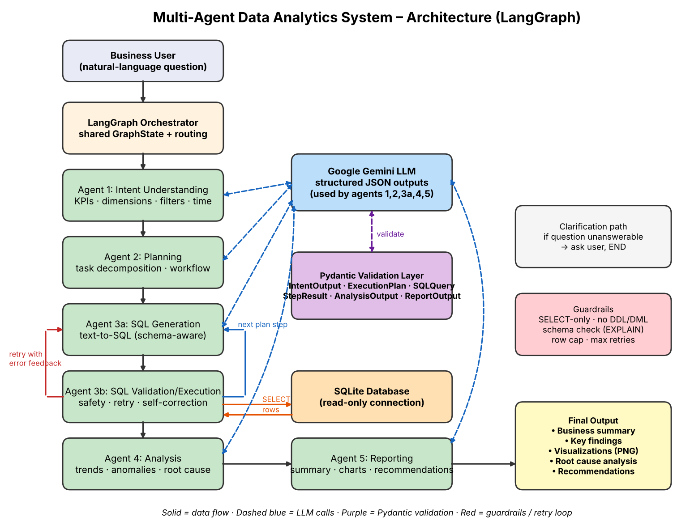
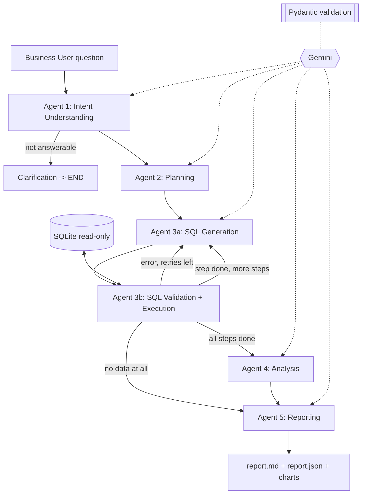

# Architecture

## Agent contracts (Pydantic)
| Agent | Input | Output model |
|---|---|---|
| Intent | question + schema | `IntentOutput` |
| Planning | `IntentOutput` + schema | `ExecutionPlan` (1-5 `PlanStep`) |
| SQL Generation | `PlanStep` + schema + prior results + last error | `SQLQuery` |
| SQL Execution | `SQLQuery` | `StepResult` |
| Analysis | all `StepResult` + pandas statistics | `AnalysisOutput` (with `RootCause`) |
| Reporting | `AnalysisOutput` + result sets | `ReportOutput` (+ `ChartSpec`, `Recommendation`) |

## Collaboration and validation
- Shared `GraphState`: each agent reads the previous agent's validated object and writes its own.
- Every Gemini response is parsed with Pydantic; on a validation error the error is fed back to Gemini (up to 3 times).
- Planner output is checked against real table names.
- SQL is checked: SELECT/WITH only, single statement, no comments, no DDL/DML keywords, `EXPLAIN QUERY PLAN` catches wrong tables/columns, read-only connection, row cap.
- SQL failures trigger a retry loop with the error message (max `MAX_SQL_RETRIES`).
- Analysis uses pandas-computed statistics (pct change, z-score outliers) so the LLM reasons over verified numbers.
